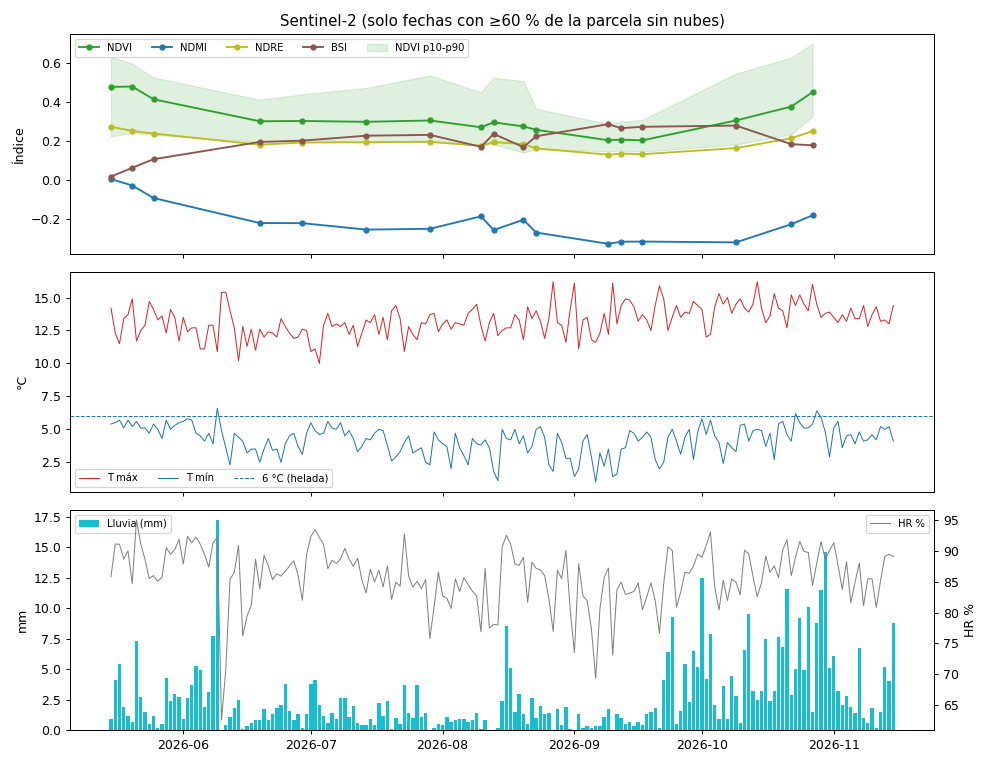

# Monitoreo de la parcela: papas_parcela
1.17 ha · centro -0.749029, -78.773999 · periodo 11/05/2026 al 15/11/2026

| Semana | Del | Pases S2 (válidos) | Imagen limpia | Vigor | Humedad | % sana / estrés | NDVI | NDMI | T mín | HR | Lluvia | Alertas | Vigilar |
|---|---|---|---|---|---|---|---|---|---|---|---|---|---|
| [2026-S46](semana_2026-S46.md) | 09/11 | 1 (0) | 27/10 | 🟡 amarillo | 🔴 rojo | 17 / 83 | 0.45 | -0.18 | 4.1 | 86 | 22.1 | - | 🟡 R4 |
| [2026-S45](semana_2026-S45.md) | 02/11 | 2 (0) | 27/10 | 🟡 amarillo | 🔴 rojo | 17 / 83 | 0.45 | -0.18 | 3.6 | 85 | 19.1 | - | 🟡 R4 |
| [2026-S44](semana_2026-S44.md) | 26/10 | 3 (1) | 27/10 | 🟡 amarillo | 🔴 rojo | 17 / 83 | 0.45 | -0.18 | 2.9 | 89 | 57.7 | - | 🟡 R4 |
| [2026-S43](semana_2026-S43.md) | 19/10 | 2 (1) | 09/10 | 🔴 rojo | 🔴 rojo | 5 / 39 | 0.37 | -0.23 | 4.1 | 89 | 48.0 | - | 🟡 R4 |
| [2026-S42](semana_2026-S42.md) | 12/10 | 2 (0) | 09/10 | 🔴 rojo | 🔴 rojo | 5 / 39 | 0.30 | -0.32 | 2.7 | 87 | 31.5 | - | 🟡 R4 |
| [2026-S41](semana_2026-S41.md) | 05/10 | 2 (1) | 09/10 | 🔴 rojo | 🔴 rojo | 5 / 39 | 0.30 | -0.32 | 2.4 | 84 | 19.8 | - | 🟡 R4 |
| [2026-S40](semana_2026-S40.md) | 28/09 | 2 (0) | 17/09 | ⚪ gris | ⚪ no aplica | 0 / 24 | 0.20 | -0.32 | 2.7 | 89 | 40.7 | - | 🟡 R4 |
| [2026-S39](semana_2026-S39.md) | 21/09 | 2 (0) | 17/09 | ⚪ gris | ⚪ no aplica | 0 / 24 | 0.20 | -0.32 | 2.0 | 85 | 27.5 | - | 🟡 R4 |
| [2026-S38](semana_2026-S38.md) | 14/09 | 2 (1) | 17/09 | ⚪ gris | ⚪ no aplica | 0 / 24 | 0.20 | -0.32 | 2.7 | 83 | 6.7 | - | 🟡 R4 |
| [2026-S37](semana_2026-S37.md) | 07/09 | 3 (2) | 23/08 | 🔴 rojo | 🔴 rojo | 0 / 43 | 0.21 | -0.32 | 1.4 | 83 | 5.9 | - | 🟡 R1; R4 |
| [2026-S36](semana_2026-S36.md) | 31/08 | 1 (0) | 23/08 | 🔴 rojo | 🔴 rojo | 0 / 43 | 0.26 | -0.27 | 1.0 | 79 | 2.4 | - | 🟡 R4 |
| [2026-S35](semana_2026-S35.md) | 24/08 | 2 (0) | 23/08 | 🔴 rojo | 🔴 rojo | 0 / 43 | 0.26 | -0.27 | 1.8 | 85 | 8.7 | 🔴 R4 | - |
| [2026-S34](semana_2026-S34.md) | 17/08 | 3 (2) | 23/08 | 🔴 rojo | 🔴 rojo | 0 / 43 | 0.26 | -0.27 | 3.2 | 88 | 15.0 | 🔴 R4 | - |
| [2026-S33](semana_2026-S33.md) | 10/08 | 2 (2) | 10/08 | 🔴 rojo | 🔴 rojo | 0 / 38 | 0.29 | -0.26 | 1.1 | 83 | 12.0 | 🔴 R4 | - |
| [2026-S32](semana_2026-S32.md) | 03/08 | 2 (0) | 29/07 | 🔴 rojo | 🔴 rojo | 9 / 41 | 0.30 | -0.25 | 2.0 | 84 | 6.2 | 🔴 R3; R4 | - |
| [2026-S31](semana_2026-S31.md) | 27/07 | 2 (1) | 29/07 | 🔴 rojo | 🔴 rojo | 9 / 41 | 0.30 | -0.25 | 2.3 | 83 | 4.7 | 🔴 R3; R4 | - |
| [2026-S30](semana_2026-S30.md) | 20/07 | 2 (0) | 14/07 | 🔴 rojo | 🔴 rojo | 2 / 55 | 0.30 | -0.25 | 2.6 | 86 | 11.4 | 🔴 R1; R4 | - |
| [2026-S29](semana_2026-S29.md) | 13/07 | 2 (1) | 14/07 | 🔴 rojo | 🔴 rojo | 2 / 55 | 0.30 | -0.25 | 3.7 | 86 | 7.9 | 🔴 R1; R4 | - |
| [2026-S28](semana_2026-S28.md) | 06/07 | 1 (0) | 29/06 | 🔴 rojo | 🔴 rojo | 1 / 72 | 0.30 | -0.22 | 3.3 | 89 | 11.2 | 🔴 R3; R4 | - |
| [2026-S27](semana_2026-S27.md) | 29/06 | 2 (1) | 29/06 | 🔴 rojo | 🔴 rojo | 1 / 72 | 0.30 | -0.22 | 3.1 | 90 | 13.3 | 🔴 R3; R4 | - |
| [2026-S26](semana_2026-S26.md) | 22/06 | 1 (0) | 25/05 | 🟡 amarillo | 🔴 rojo | 0 / 85 | 0.30 | -0.22 | 2.5 | 87 | 12.7 | 🔴 R1; R4 | - |
| [2026-S25](semana_2026-S25.md) | 15/06 | 1 (1) | 25/05 | 🟡 amarillo | 🔴 rojo | 0 / 85 | 0.30 | -0.22 | 2.5 | 84 | 5.1 | 🔴 R1; R4 | - |
| [2026-S24](semana_2026-S24.md) | 08/06 | 2 (0) | 25/05 | 🟡 amarillo | 🔴 rojo | 0 / 85 | 0.41 | -0.09 | 2.3 | 83 | 30.7 | 🔴 R4 | - |
| [2026-S23](semana_2026-S23.md) | 01/06 | 1 (0) | 25/05 | 🟡 amarillo | 🔴 rojo | 0 / 85 | 0.41 | -0.09 | 4.1 | 90 | 22.4 | 🔴 R1; R4 | - |
| [2026-S22](semana_2026-S22.md) | 25/05 | 2 (1) | 25/05 | 🟡 amarillo | 🔴 rojo | 0 / 85 | 0.41 | -0.09 | 4.3 | 88 | 14.3 | 🔴 R1; R4 | - |
| [2026-S21](semana_2026-S21.md) | 18/05 | 1 (1) | s/d | - | - | - | 0.48 | -0.03 | 4.7 | 89 | 15.8 | 🔴 R4 | - |
| [2026-S20](semana_2026-S20.md) | 11/05 | 1 (1) | s/d | - | - | - | 0.48 | 0.00 | 5.4 | 89 | 10.4 | 🔴 R4 | - |
