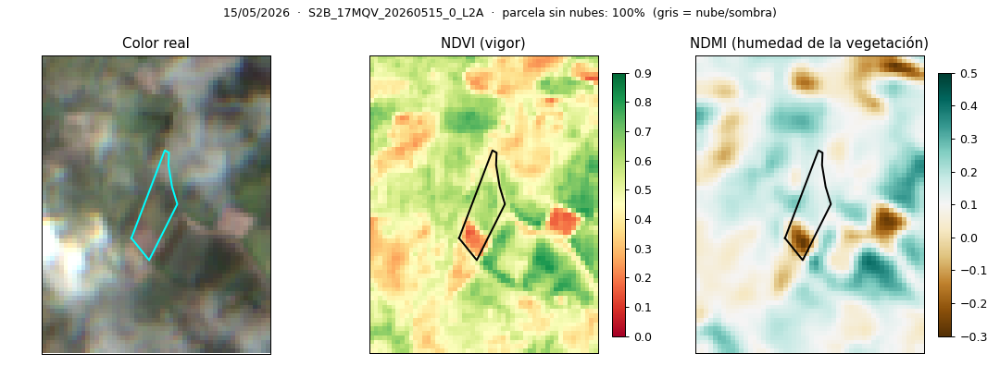

# Reporte semanal 2026-S20: 11/05/2026 al 17/05/2026
**Parcela:** papas_parcela · 1.17 ha · centro -0.749029, -78.773999  

## Alertas para el agricultor
- 🔴 **Heladas**: "Alta probabilidad de heladas en las próximas 2 a 4 semanas. Prepara sistemas de prevención."  
  _Porque:_ T mínima de la semana 5.4 °C (3 noches < 6 °C); junio: madrugadas históricamente despejado.

## Sentinel-2 de precisión (10 m, polígono exacto)
_Aún no hay imagen limpia._

## Detalle de todos los pases del satélite (Sentinel-2 L2A)
| Fecha | Escena | Parcela sin nubes | Nubes | Estado |
|---|---|---|---|---|
| 15/05 | S2B_17MQV_20260515_0_L2A | 100% | 0% | ok |

**Último dato válido:** 15/05/2026  
| Índice | Valor | Anterior | Cambio | Qué indica |
|---|---|---|---|---|
| NDVI | 0.475 | s/d | s/d | vigor / biomasa verde |
| NDMI | 0.005 | s/d | s/d | humedad de la vegetación |
| NDRE | 0.272 | s/d | s/d | clorofila / nitrógeno (red edge) |
| EVI | 0.341 | s/d | s/d | vigor, corrige suelo y atmósfera |
| SAVI | 0.299 | s/d | s/d | vigor con suelo expuesto |
| BSI | 0.017 | s/d | s/d | suelo desnudo (más alto = más suelo) |
| NDWI | -0.498 | s/d | s/d | agua superficial / encharcamiento |
| MSI | 1.067 | s/d | s/d | estrés hídrico (más alto = más seco) |

## Clima de la semana (Open-Meteo)
| T mín | T máx | T media | HR media | Lluvia | Radiación | Noches < 6 °C |
|---|---|---|---|---|---|---|
| 5.4 °C | 14.2 °C | 8.4 °C | 89 % | 10.4 mm | 20.1 MJ/m²/día | 3 de 3 |

_Fuente: ERA5 (reanálisis); 3 días con dato._

## Tendencia histórica del próximo mes: junio (promedio 2011-2025)
| Lluvia | T mín media | Radiación | Nubes de madrugada | Días con T mín < 6 °C |
|---|---|---|---|---|
| 75 mm (seco) | 4.3 °C | 17.6 MJ/m²/día (baja) | 89 % (despejado) | 25 |

## Reglas evaluadas (provisionales, ver `reglas.py`)
| Regla | Si hoy ocurre esto | ¿Se cumple? | + Próximo mes | ¿Se cumple? | Resultado |
|---|---|---|---|---|---|
| R1 Riesgo de sequía | Humedad baja en Sentinel-2 (NDMI cayendo): NDMI 0.00 (cambio s/d en s/d días) | ❌ | Mes históricamente seco: junio: 75 mm históricos (seco) | ✅ | ninguna |
| R2 Plagas y hongos (lancha / tizón tardío) | Humedad alta + temperaturas templadas (15-20 °C): HR media 89 %, T media 8.4 °C | ❌ | Mes históricamente lluvioso: junio: 75 mm históricos (seco) | ❌ | ninguna |
| R3 Déficit de nutrientes | Vigor (NDVI) estancado en etapa de crecimiento: sin dato satelital reciente o sin observación previa | ➖ | Alta radiación solar esperada: junio: radiación histórica baja | ❌ | ninguna |
| R4 Heladas | Temperaturas mínimas actuales < 6 °C: T mínima de la semana 5.4 °C (3 noches < 6 °C) | ✅ | Mes de cielos despejados nocturnos: junio: madrugadas históricamente despejado | ✅ | ALERTA |
