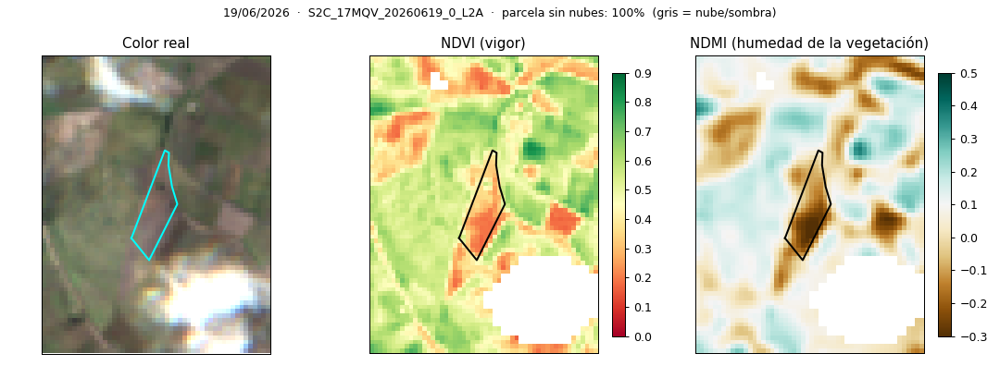

# Reporte semanal 2026-S25: 15/06/2026 al 21/06/2026
**Parcela:** papas_parcela · 1.17 ha · centro -0.749029, -78.773999  

## Alertas para el agricultor
- 🔴 **Riesgo de sequía**: "Riesgo alto de sequía el próximo mes. Programa riego suplementario desde esta semana."  
  _Porque:_ NDMI -0.22 (cambio -0.13 en 25 días); julio: 52 mm históricos (seco).
- 🔴 **Heladas**: "Alta probabilidad de heladas en las próximas 2 a 4 semanas. Prepara sistemas de prevención."  
  _Porque:_ T mínima de la semana 2.5 °C (7 noches < 6 °C); julio: madrugadas históricamente despejado.

## Sentinel-2 de precisión (10 m, polígono exacto)
**Última captura satelital limpia: hace 27 días** (25/05/2026, nubosidad en el polígono 0 %)  
Comparada con la imagen limpia anterior: primera del periodo

| | Estado | Mensaje para el agricultor |
|---|---|---|
| **Vigor y plagas** (NDVI 0.41, NDRE 0.24) | 🟡 amarillo | Baja concentración de clorofila. Posible falta de nitrógeno o crecimiento lento; revisa fertilización. |
| **Humedad** (NDMI -0.09) | 🔴 rojo | Estrés hídrico detectado en las hojas de la parcela. El cultivo está perdiendo turgencia; activa riego. |

**Salud del lote:** 0 % del área sana (verde) · 85 % con estrés (amarillo + rojo) · ⚪ gris 15 % · 🟡 amarillo 71 % · 🔴 rojo 14 %
  
**Sector más afectado:** sur (31 % de sus píxeles en rojo)

 

## Detalle de todos los pases del satélite (Sentinel-2 L2A)
| Fecha | Escena | Parcela sin nubes | Nubes | Estado |
|---|---|---|---|---|
| 19/06 | S2C_17MQV_20260619_0_L2A | 100% | 0% | ok |

**Último dato válido:** 19/06/2026  
**Comparado con:** 25/05/2026 (25 días antes)

| Índice | Valor | Anterior | Cambio | Qué indica |
|---|---|---|---|---|
| NDVI | 0.300 | 0.412 | -0.113 | vigor / biomasa verde |
| NDMI | -0.220 | -0.093 | -0.128 | humedad de la vegetación |
| NDRE | 0.180 | 0.237 | -0.057 | clorofila / nitrógeno (red edge) |
| EVI | 0.179 | 0.253 | -0.074 | vigor, corrige suelo y atmósfera |
| SAVI | 0.165 | 0.238 | -0.074 | vigor con suelo expuesto |
| BSI | 0.194 | 0.106 | 0.088 | suelo desnudo (más alto = más suelo) |
| NDWI | -0.371 | -0.484 | 0.113 | agua superficial / encharcamiento |
| MSI | 1.608 | 1.254 | 0.355 | estrés hídrico (más alto = más seco) |

## Clima de la semana (Open-Meteo)
| T mín | T máx | T media | HR media | Lluvia | Radiación | Noches < 6 °C |
|---|---|---|---|---|---|---|
| 2.5 °C | 12.8 °C | 7.0 °C | 84 % | 5.1 mm | 19.5 MJ/m²/día | 7 de 7 |

_Fuente: ERA5 (reanálisis); 7 días con dato._

## Tendencia histórica del próximo mes: julio (promedio 2011-2025)
| Lluvia | T mín media | Radiación | Nubes de madrugada | Días con T mín < 6 °C |
|---|---|---|---|---|
| 52 mm (seco) | 4.0 °C | 17.8 MJ/m²/día (baja) | 87 % (despejado) | 26 |

## Reglas evaluadas (provisionales, ver `reglas.py`)
| Regla | Si hoy ocurre esto | ¿Se cumple? | + Próximo mes | ¿Se cumple? | Resultado |
|---|---|---|---|---|---|
| R1 Riesgo de sequía | Humedad baja en Sentinel-2 (NDMI cayendo): NDMI -0.22 (cambio -0.13 en 25 días) | ✅ | Mes históricamente seco: julio: 52 mm históricos (seco) | ✅ | ALERTA |
| R2 Plagas y hongos (lancha / tizón tardío) | Humedad alta + temperaturas templadas (15-20 °C): HR media 84 %, T media 7.0 °C | ❌ | Mes históricamente lluvioso: julio: 52 mm históricos (seco) | ❌ | ninguna |
| R3 Déficit de nutrientes | Vigor (NDVI) estancado en etapa de crecimiento: NDVI 0.30 (cambio -0.11 en 25 días) | ❌ | Alta radiación solar esperada: julio: radiación histórica baja | ❌ | ninguna |
| R4 Heladas | Temperaturas mínimas actuales < 6 °C: T mínima de la semana 2.5 °C (7 noches < 6 °C) | ✅ | Mes de cielos despejados nocturnos: julio: madrugadas históricamente despejado | ✅ | ALERTA |
