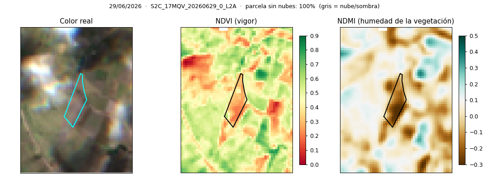

# Reporte semanal 2026-S28: 06/07/2026 al 12/07/2026
**Parcela:** papas_parcela · 1.17 ha · centro -0.749029, -78.773999  

## Alertas para el agricultor
- 🔴 **Déficit de nutrientes**: "Posible déficit de nutrientes (nitrógeno/potasio) en las próximas semanas; evalúa fertilización foliar."  
  _Porque:_ NDVI 0.30 (cambio 0.00 en 10 días); agosto: radiación histórica alta.
- 🔴 **Heladas**: "Alta probabilidad de heladas en las próximas 2 a 4 semanas. Prepara sistemas de prevención."  
  _Porque:_ T mínima de la semana 3.3 °C (7 noches < 6 °C); agosto: madrugadas históricamente despejado.

## Sentinel-2 de precisión (10 m, polígono exacto)
**Última captura satelital limpia: hace 13 días** (29/06/2026, nubosidad en el polígono 0 %)  
Comparada con la imagen limpia anterior: 25/05/2026 (35 días antes), cambio de NDVI -0.111

| | Estado | Mensaje para el agricultor |
|---|---|---|
| **Vigor y plagas** (NDVI 0.30, NDRE 0.19) | 🔴 rojo | Alerta de estrés severo o ataque de plagas/lancha en focos específicos. Inspecciona las zonas rojas del mapa. |
| **Humedad** (NDMI -0.22) | 🔴 rojo | Estrés hídrico detectado en las hojas de la parcela. El cultivo está perdiendo turgencia; activa riego. |

**Salud del lote:** 1 % del área sana (verde) · 72 % con estrés (amarillo + rojo) · ⚪ gris 27 % · 🟢 verde 1 % · 🟡 amarillo 12 % · 🔴 rojo 61 %
  
**Sector más afectado:** norte (96 % de sus píxeles en rojo)

 

## Detalle de todos los pases del satélite (Sentinel-2 L2A)
| Fecha | Escena | Parcela sin nubes | Nubes | Estado |
|---|---|---|---|---|
| 09/07 | S2C_17MQV_20260709_0_L2A | 0% | 100% | nublado (sin descarga) |

**Último dato válido:** 29/06/2026  
**Comparado con:** 19/06/2026 (10 días antes)

| Índice | Valor | Anterior | Cambio | Qué indica |
|---|---|---|---|---|
| NDVI | 0.301 | 0.300 | 0.002 | vigor / biomasa verde |
| NDMI | -0.221 | -0.220 | -0.001 | humedad de la vegetación |
| NDRE | 0.191 | 0.180 | 0.011 | clorofila / nitrógeno (red edge) |
| EVI | 0.192 | 0.179 | 0.013 | vigor, corrige suelo y atmósfera |
| SAVI | 0.176 | 0.165 | 0.011 | vigor con suelo expuesto |
| BSI | 0.201 | 0.194 | 0.007 | suelo desnudo (más alto = más suelo) |
| NDWI | -0.382 | -0.371 | -0.011 | agua superficial / encharcamiento |
| MSI | 1.600 | 1.608 | -0.008 | estrés hídrico (más alto = más seco) |

## Clima de la semana (Open-Meteo)
| T mín | T máx | T media | HR media | Lluvia | Radiación | Noches < 6 °C |
|---|---|---|---|---|---|---|
| 3.3 °C | 13.1 °C | 7.7 °C | 89 % | 11.2 mm | 19.3 MJ/m²/día | 7 de 7 |

_Fuente: ERA5 (reanálisis); 7 días con dato._

## Tendencia histórica del próximo mes: agosto (promedio 2011-2025)
| Lluvia | T mín media | Radiación | Nubes de madrugada | Días con T mín < 6 °C |
|---|---|---|---|---|
| 56 mm (seco) | 3.7 °C | 19.8 MJ/m²/día (alta) | 81 % (despejado) | 27 |

## Reglas evaluadas (provisionales, ver `reglas.py`)
| Regla | Si hoy ocurre esto | ¿Se cumple? | + Próximo mes | ¿Se cumple? | Resultado |
|---|---|---|---|---|---|
| R1 Riesgo de sequía | Humedad baja en Sentinel-2 (NDMI cayendo): NDMI -0.22 (cambio -0.00 en 10 días) | ❌ | Mes históricamente seco: agosto: 56 mm históricos (seco) | ✅ | ninguna |
| R2 Plagas y hongos (lancha / tizón tardío) | Humedad alta + temperaturas templadas (15-20 °C): HR media 89 %, T media 7.7 °C | ❌ | Mes históricamente lluvioso: agosto: 56 mm históricos (seco) | ❌ | ninguna |
| R3 Déficit de nutrientes | Vigor (NDVI) estancado en etapa de crecimiento: NDVI 0.30 (cambio 0.00 en 10 días) | ✅ | Alta radiación solar esperada: agosto: radiación histórica alta | ✅ | ALERTA |
| R4 Heladas | Temperaturas mínimas actuales < 6 °C: T mínima de la semana 3.3 °C (7 noches < 6 °C) | ✅ | Mes de cielos despejados nocturnos: agosto: madrugadas históricamente despejado | ✅ | ALERTA |
