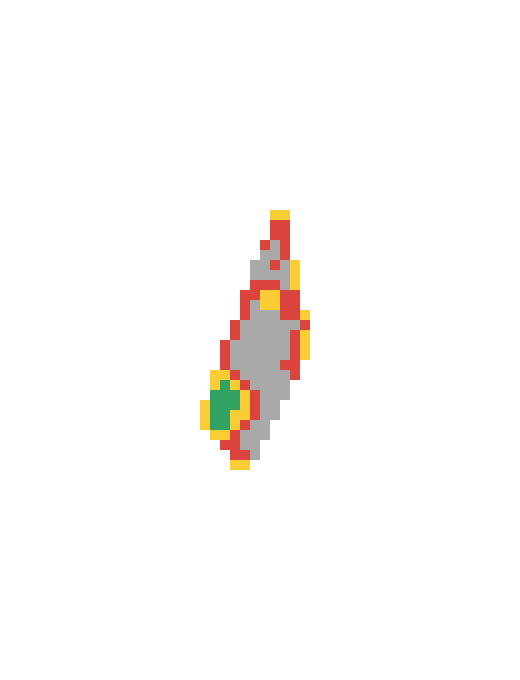
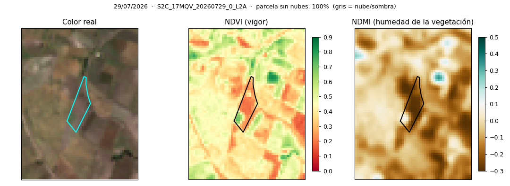

# Reporte semanal 2026-S32: 03/08/2026 al 09/08/2026
**Parcela:** papas_parcela · 1.17 ha · centro -0.749029, -78.773999  

## Alertas para el agricultor
- 🔴 **Déficit de nutrientes**: "Posible déficit de nutrientes (nitrógeno/potasio) en las próximas semanas; evalúa fertilización foliar."  
  _Porque:_ NDVI 0.30 (cambio 0.01 en 15 días); septiembre: radiación histórica alta.
- 🔴 **Heladas**: "Alta probabilidad de heladas en las próximas 2 a 4 semanas. Prepara sistemas de prevención."  
  _Porque:_ T mínima de la semana 2.0 °C (7 noches < 6 °C); septiembre: madrugadas históricamente despejado.

## Sentinel-2 de precisión (10 m, polígono exacto)
**Última captura satelital limpia: hace 11 días** (29/07/2026, nubosidad en el polígono 0 %)  
Comparada con la imagen limpia anterior: 14/07/2026 (15 días antes), cambio de NDVI +0.007

| | Estado | Mensaje para el agricultor |
|---|---|---|
| **Vigor y plagas** (NDVI 0.30, NDRE 0.20) | 🔴 rojo | Alerta de estrés severo o ataque de plagas/lancha en focos específicos. Inspecciona las zonas rojas del mapa. |
| **Humedad** (NDMI -0.25) | 🔴 rojo | Estrés hídrico detectado en las hojas de la parcela. El cultivo está perdiendo turgencia; activa riego. |

**Salud del lote:** 9 % del área sana (verde) · 41 % con estrés (amarillo + rojo) · ⚪ gris 50 % · 🟢 verde 9 % · 🟡 amarillo 13 % · 🔴 rojo 28 %
  
**Sector más afectado:** norte (39 % de sus píxeles en rojo)

 

## Detalle de todos los pases del satélite (Sentinel-2 L2A)
| Fecha | Escena | Parcela sin nubes | Nubes | Estado |
|---|---|---|---|---|
| 03/08 | S2B_17MQV_20260803_0_L2A | 0% | 100% | nublado (sin descarga) |
| 08/08 | S2C_17MQV_20260808_0_L2A | 0% | 100% | nublado (sin descarga) |

**Último dato válido:** 29/07/2026  
**Comparado con:** 14/07/2026 (15 días antes)

| Índice | Valor | Anterior | Cambio | Qué indica |
|---|---|---|---|---|
| NDVI | 0.304 | 0.297 | 0.007 | vigor / biomasa verde |
| NDMI | -0.250 | -0.254 | 0.004 | humedad de la vegetación |
| NDRE | 0.195 | 0.192 | 0.003 | clorofila / nitrógeno (red edge) |
| EVI | 0.166 | 0.158 | 0.009 | vigor, corrige suelo y atmósfera |
| SAVI | 0.160 | 0.150 | 0.010 | vigor con suelo expuesto |
| BSI | 0.230 | 0.226 | 0.004 | suelo desnudo (más alto = más suelo) |
| NDWI | -0.386 | -0.377 | -0.008 | agua superficial / encharcamiento |
| MSI | 1.733 | 1.729 | 0.004 | estrés hídrico (más alto = más seco) |

## Clima de la semana (Open-Meteo)
| T mín | T máx | T media | HR media | Lluvia | Radiación | Noches < 6 °C |
|---|---|---|---|---|---|---|
| 2.0 °C | 14.5 °C | 7.4 °C | 84 % | 6.2 mm | 21.2 MJ/m²/día | 7 de 7 |

_Fuente: ERA5 (reanálisis); 7 días con dato._

## Tendencia histórica del próximo mes: septiembre (promedio 2011-2025)
| Lluvia | T mín media | Radiación | Nubes de madrugada | Días con T mín < 6 °C |
|---|---|---|---|---|
| 80 mm (seco) | 3.7 °C | 21.1 MJ/m²/día (alta) | 80 % (despejado) | 28 |

## Reglas evaluadas (provisionales, ver `reglas.py`)
| Regla | Si hoy ocurre esto | ¿Se cumple? | + Próximo mes | ¿Se cumple? | Resultado |
|---|---|---|---|---|---|
| R1 Riesgo de sequía | Humedad baja en Sentinel-2 (NDMI cayendo): NDMI -0.25 (cambio 0.00 en 15 días) | ❌ | Mes históricamente seco: septiembre: 80 mm históricos (seco) | ✅ | ninguna |
| R2 Plagas y hongos (lancha / tizón tardío) | Humedad alta + temperaturas templadas (15-20 °C): HR media 84 %, T media 7.4 °C | ❌ | Mes históricamente lluvioso: septiembre: 80 mm históricos (seco) | ❌ | ninguna |
| R3 Déficit de nutrientes | Vigor (NDVI) estancado en etapa de crecimiento: NDVI 0.30 (cambio 0.01 en 15 días) | ✅ | Alta radiación solar esperada: septiembre: radiación histórica alta | ✅ | ALERTA |
| R4 Heladas | Temperaturas mínimas actuales < 6 °C: T mínima de la semana 2.0 °C (7 noches < 6 °C) | ✅ | Mes de cielos despejados nocturnos: septiembre: madrugadas históricamente despejado | ✅ | ALERTA |
