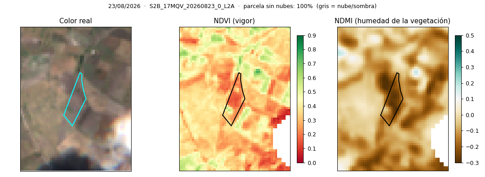

# Reporte semanal 2026-S34: 17/08/2026 al 23/08/2026
**Parcela:** papas_parcela · 1.17 ha · centro -0.749029, -78.773999  

## Alertas para el agricultor
- 🔴 **Heladas**: "Alta probabilidad de heladas en las próximas 2 a 4 semanas. Prepara sistemas de prevención."  
  _Porque:_ T mínima de la semana 3.2 °C (7 noches < 6 °C); septiembre: madrugadas históricamente despejado.

## Sentinel-2 de precisión (10 m, polígono exacto)
**Última captura satelital limpia: hace 0 días** (23/08/2026, nubosidad en el polígono 0 %)  
Comparada con la imagen limpia anterior: 10/08/2026 (13 días antes), cambio de NDVI -0.013

| | Estado | Mensaje para el agricultor |
|---|---|---|
| **Vigor y plagas** (NDVI 0.26, NDRE 0.16) | 🔴 rojo | Alerta de estrés severo o ataque de plagas/lancha en focos específicos. Inspecciona las zonas rojas del mapa. |
| **Humedad** (NDMI -0.27) | 🔴 rojo | Estrés hídrico detectado en las hojas de la parcela. El cultivo está perdiendo turgencia; activa riego. |

**Salud del lote:** 0 % del área sana (verde) · 43 % con estrés (amarillo + rojo) · ⚪ gris 57 % · 🟡 amarillo 12 % · 🔴 rojo 31 %
  
**Sector más afectado:** sur (40 % de sus píxeles en rojo)

 

## Detalle de todos los pases del satélite (Sentinel-2 L2A)
| Fecha | Escena | Parcela sin nubes | Nubes | Estado |
|---|---|---|---|---|
| 18/08 | S2C_17MQV_20260818_0_L2A | 0% | 100% | nublado (sin descarga) |
| 20/08 | S2A_17MQV_20260820_0_L2A | 99% | 0% | ok |
| 23/08 | S2B_17MQV_20260823_0_L2A | 100% | 0% | ok |

**Último dato válido:** 23/08/2026  
**Comparado con:** 13/08/2026 (10 días antes)

| Índice | Valor | Anterior | Cambio | Qué indica |
|---|---|---|---|---|
| NDVI | 0.256 | 0.294 | -0.038 | vigor / biomasa verde |
| NDMI | -0.269 | -0.256 | -0.013 | humedad de la vegetación |
| NDRE | 0.161 | 0.194 | -0.033 | clorofila / nitrógeno (red edge) |
| EVI | 0.155 | 0.161 | -0.007 | vigor, corrige suelo y atmósfera |
| SAVI | 0.139 | 0.156 | -0.017 | vigor con suelo expuesto |
| BSI | 0.223 | 0.235 | -0.012 | suelo desnudo (más alto = más suelo) |
| NDWI | -0.322 | -0.389 | 0.066 | agua superficial / encharcamiento |
| MSI | 1.765 | 1.754 | 0.011 | estrés hídrico (más alto = más seco) |

## Clima de la semana (Open-Meteo)
| T mín | T máx | T media | HR media | Lluvia | Radiación | Noches < 6 °C |
|---|---|---|---|---|---|---|
| 3.2 °C | 14.3 °C | 7.8 °C | 88 % | 15.0 mm | 21.4 MJ/m²/día | 7 de 7 |

_Fuente: ERA5 (reanálisis); 7 días con dato._

## Tendencia histórica del próximo mes: septiembre (promedio 2011-2025)
| Lluvia | T mín media | Radiación | Nubes de madrugada | Días con T mín < 6 °C |
|---|---|---|---|---|
| 80 mm (seco) | 3.7 °C | 21.1 MJ/m²/día (alta) | 80 % (despejado) | 28 |

## Reglas evaluadas (provisionales, ver `reglas.py`)
| Regla | Si hoy ocurre esto | ¿Se cumple? | + Próximo mes | ¿Se cumple? | Resultado |
|---|---|---|---|---|---|
| R1 Riesgo de sequía | Humedad baja en Sentinel-2 (NDMI cayendo): NDMI -0.27 (cambio -0.01 en 10 días) | ❌ | Mes históricamente seco: septiembre: 80 mm históricos (seco) | ✅ | ninguna |
| R2 Plagas y hongos (lancha / tizón tardío) | Humedad alta + temperaturas templadas (15-20 °C): HR media 88 %, T media 7.8 °C | ❌ | Mes históricamente lluvioso: septiembre: 80 mm históricos (seco) | ❌ | ninguna |
| R3 Déficit de nutrientes | Vigor (NDVI) estancado en etapa de crecimiento: NDVI 0.26 (cambio -0.04 en 10 días) | ❌ | Alta radiación solar esperada: septiembre: radiación histórica alta | ✅ | ninguna |
| R4 Heladas | Temperaturas mínimas actuales < 6 °C: T mínima de la semana 3.2 °C (7 noches < 6 °C) | ✅ | Mes de cielos despejados nocturnos: septiembre: madrugadas históricamente despejado | ✅ | ALERTA |
