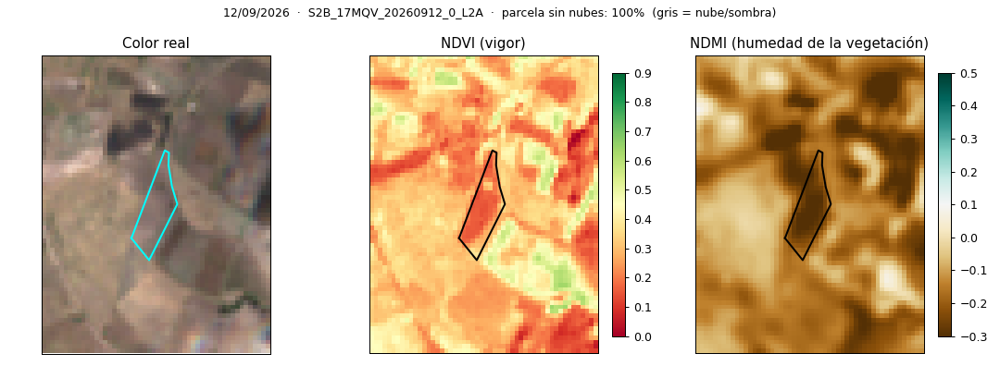

# Reporte semanal 2026-S37: 07/09/2026 al 13/09/2026
**Parcela:** papas_parcela · 1.17 ha · centro -0.749029, -78.773999  

## Alertas para el agricultor
- 🟢 Sin alertas esta semana.
- 🟡 **Vigilar: Riesgo de sequía**: se cumple la condición actual (NDMI -0.32 (cambio -0.05 en 20 días)), pero no la tendencia del próximo mes (octubre: 170 mm históricos (normal)).
- 🟡 **Vigilar: Heladas**: se cumple la condición actual (T mínima de la semana 1.4 °C (7 noches < 6 °C)), pero no la tendencia del próximo mes (octubre: madrugadas históricamente normal).

## Sentinel-2 de precisión (10 m, polígono exacto)
**Última captura satelital limpia: hace 21 días** (23/08/2026, nubosidad en el polígono 0 %)  
Comparada con la imagen limpia anterior: 10/08/2026 (13 días antes), cambio de NDVI -0.013

| | Estado | Mensaje para el agricultor |
|---|---|---|
| **Vigor y plagas** (NDVI 0.26, NDRE 0.16) | 🔴 rojo | Alerta de estrés severo o ataque de plagas/lancha en focos específicos. Inspecciona las zonas rojas del mapa. |
| **Humedad** (NDMI -0.27) | 🔴 rojo | Estrés hídrico detectado en las hojas de la parcela. El cultivo está perdiendo turgencia; activa riego. |

**Salud del lote:** 0 % del área sana (verde) · 43 % con estrés (amarillo + rojo) · ⚪ gris 57 % · 🟡 amarillo 12 % · 🔴 rojo 31 %
  
**Sector más afectado:** sur (40 % de sus píxeles en rojo)

 

## Detalle de todos los pases del satélite (Sentinel-2 L2A)
| Fecha | Escena | Parcela sin nubes | Nubes | Estado |
|---|---|---|---|---|
| 07/09 | S2C_17MQV_20260907_0_L2A | 0% | 100% | nublado (sin descarga) |
| 09/09 | S2A_17MQV_20260909_0_L2A | 100% | 0% | ok |
| 12/09 | S2B_17MQV_20260912_0_L2A | 100% | 0% | ok |

**Último dato válido:** 12/09/2026  
**Comparado con:** 23/08/2026 (20 días antes)

| Índice | Valor | Anterior | Cambio | Qué indica |
|---|---|---|---|---|
| NDVI | 0.206 | 0.256 | -0.050 | vigor / biomasa verde |
| NDMI | -0.316 | -0.269 | -0.047 | humedad de la vegetación |
| NDRE | 0.135 | 0.161 | -0.026 | clorofila / nitrógeno (red edge) |
| EVI | 0.120 | 0.155 | -0.035 | vigor, corrige suelo y atmósfera |
| SAVI | 0.111 | 0.139 | -0.028 | vigor con suelo expuesto |
| BSI | 0.264 | 0.223 | 0.041 | suelo desnudo (más alto = más suelo) |
| NDWI | -0.295 | -0.322 | 0.027 | agua superficial / encharcamiento |
| MSI | 1.937 | 1.765 | 0.173 | estrés hídrico (más alto = más seco) |

## Clima de la semana (Open-Meteo)
| T mín | T máx | T media | HR media | Lluvia | Radiación | Noches < 6 °C |
|---|---|---|---|---|---|---|
| 1.4 °C | 16.1 °C | 7.5 °C | 83 % | 5.9 mm | 21.9 MJ/m²/día | 7 de 7 |

_Fuente: ERA5 (reanálisis); 7 días con dato._

## Tendencia histórica del próximo mes: octubre (promedio 2011-2025)
| Lluvia | T mín media | Radiación | Nubes de madrugada | Días con T mín < 6 °C |
|---|---|---|---|---|
| 170 mm (normal) | 4.2 °C | 19.8 MJ/m²/día (alta) | 89 % (normal) | 26 |

## Reglas evaluadas (provisionales, ver `reglas.py`)
| Regla | Si hoy ocurre esto | ¿Se cumple? | + Próximo mes | ¿Se cumple? | Resultado |
|---|---|---|---|---|---|
| R1 Riesgo de sequía | Humedad baja en Sentinel-2 (NDMI cayendo): NDMI -0.32 (cambio -0.05 en 20 días) | ✅ | Mes históricamente seco: octubre: 170 mm históricos (normal) | ❌ | VIGILAR |
| R2 Plagas y hongos (lancha / tizón tardío) | Humedad alta + temperaturas templadas (15-20 °C): HR media 83 %, T media 7.5 °C | ❌ | Mes históricamente lluvioso: octubre: 170 mm históricos (normal) | ❌ | ninguna |
| R3 Déficit de nutrientes | Vigor (NDVI) estancado en etapa de crecimiento: NDVI 0.21 (cambio -0.05 en 20 días) | ❌ | Alta radiación solar esperada: octubre: radiación histórica alta | ✅ | ninguna |
| R4 Heladas | Temperaturas mínimas actuales < 6 °C: T mínima de la semana 1.4 °C (7 noches < 6 °C) | ✅ | Mes de cielos despejados nocturnos: octubre: madrugadas históricamente normal | ❌ | VIGILAR |
