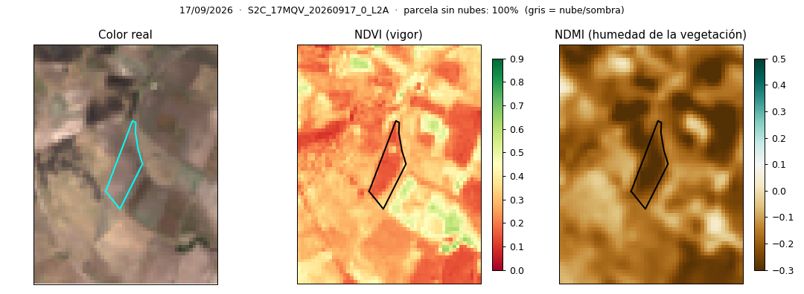

# Reporte semanal 2026-S38: 14/09/2026 al 20/09/2026
**Parcela:** papas_parcela · 1.17 ha · centro -0.749029, -78.773999  

## Alertas para el agricultor
- 🟢 Sin alertas esta semana.
- 🟡 **Vigilar: Heladas**: se cumple la condición actual (T mínima de la semana 2.7 °C (7 noches < 6 °C)), pero no la tendencia del próximo mes (octubre: madrugadas históricamente normal).

## Sentinel-2 de precisión (10 m, polígono exacto)
**Última captura satelital limpia: hace 3 días** (17/09/2026, nubosidad en el polígono 0 %)  
Comparada con la imagen limpia anterior: 23/08/2026 (25 días antes), cambio de NDVI -0.054

| | Estado | Mensaje para el agricultor |
|---|---|---|
| **Vigor y plagas** (NDVI 0.20, NDRE 0.13) | ⚪ gris | Suelo desnudo, emergencia inicial o parcela recién cosechada. |
| **Humedad** (NDMI -0.32) | ⚪ no aplica | Suelo desnudo: el NDMI no refleja el agua del cultivo. |

**Salud del lote:** 0 % del área sana (verde) · 24 % con estrés (amarillo + rojo) · ⚪ gris 76 % · 🟡 amarillo 3 % · 🔴 rojo 21 %
  
**Sector más afectado:** sur (33 % de sus píxeles en rojo)

 

## Detalle de todos los pases del satélite (Sentinel-2 L2A)
| Fecha | Escena | Parcela sin nubes | Nubes | Estado |
|---|---|---|---|---|
| 17/09 | S2C_17MQV_20260917_0_L2A | 100% | 0% | ok |
| 19/09 | S2A_17MQV_20260919_0_L2A | 0% | 100% | nublado (sin descarga) |

**Último dato válido:** 17/09/2026  
**Comparado con:** 09/09/2026 (8 días antes)

| Índice | Valor | Anterior | Cambio | Qué indica |
|---|---|---|---|---|
| NDVI | 0.202 | 0.203 | -0.001 | vigor / biomasa verde |
| NDMI | -0.315 | -0.327 | 0.012 | humedad de la vegetación |
| NDRE | 0.131 | 0.129 | 0.003 | clorofila / nitrógeno (red edge) |
| EVI | 0.118 | 0.114 | 0.004 | vigor, corrige suelo y atmósfera |
| SAVI | 0.111 | 0.109 | 0.002 | vigor con suelo expuesto |
| BSI | 0.271 | 0.285 | -0.014 | suelo desnudo (más alto = más suelo) |
| NDWI | -0.299 | -0.305 | 0.006 | agua superficial / encharcamiento |
| MSI | 1.934 | 1.987 | -0.053 | estrés hídrico (más alto = más seco) |

## Clima de la semana (Open-Meteo)
| T mín | T máx | T media | HR media | Lluvia | Radiación | Noches < 6 °C |
|---|---|---|---|---|---|---|
| 2.7 °C | 14.8 °C | 8.0 °C | 83 % | 6.7 mm | 20.2 MJ/m²/día | 7 de 7 |

_Fuente: ERA5 (reanálisis); 7 días con dato._

## Tendencia histórica del próximo mes: octubre (promedio 2011-2025)
| Lluvia | T mín media | Radiación | Nubes de madrugada | Días con T mín < 6 °C |
|---|---|---|---|---|
| 170 mm (normal) | 4.2 °C | 19.8 MJ/m²/día (alta) | 89 % (normal) | 26 |

## Reglas evaluadas (provisionales, ver `reglas.py`)
| Regla | Si hoy ocurre esto | ¿Se cumple? | + Próximo mes | ¿Se cumple? | Resultado |
|---|---|---|---|---|---|
| R1 Riesgo de sequía | Humedad baja en Sentinel-2 (NDMI cayendo): NDMI -0.32 (cambio 0.01 en 8 días) | ❌ | Mes históricamente seco: octubre: 170 mm históricos (normal) | ❌ | ninguna |
| R2 Plagas y hongos (lancha / tizón tardío) | Humedad alta + temperaturas templadas (15-20 °C): HR media 83 %, T media 8.0 °C | ❌ | Mes históricamente lluvioso: octubre: 170 mm históricos (normal) | ❌ | ninguna |
| R3 Déficit de nutrientes | Vigor (NDVI) estancado en etapa de crecimiento: NDVI 0.20 (cambio -0.00 en 8 días) | ❌ | Alta radiación solar esperada: octubre: radiación histórica alta | ✅ | ninguna |
| R4 Heladas | Temperaturas mínimas actuales < 6 °C: T mínima de la semana 2.7 °C (7 noches < 6 °C) | ✅ | Mes de cielos despejados nocturnos: octubre: madrugadas históricamente normal | ❌ | VIGILAR |
