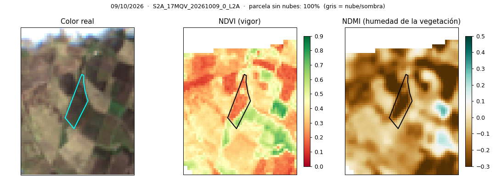

# Reporte semanal 2026-S41: 05/10/2026 al 11/10/2026
**Parcela:** papas_parcela · 1.17 ha · centro -0.749029, -78.773999  

## Alertas para el agricultor
- 🟢 Sin alertas esta semana.
- 🟡 **Vigilar: Heladas**: se cumple la condición actual (T mínima de la semana 2.4 °C (7 noches < 6 °C)), pero no la tendencia del próximo mes (noviembre: madrugadas históricamente nublado).

## Sentinel-2 de precisión (10 m, polígono exacto)
**Última captura satelital limpia: hace 2 días** (09/10/2026, nubosidad en el polígono 0 %)  
Comparada con la imagen limpia anterior: 17/09/2026 (22 días antes), cambio de NDVI +0.102

| | Estado | Mensaje para el agricultor |
|---|---|---|
| **Vigor y plagas** (NDVI 0.30, NDRE 0.16) | 🔴 rojo | Alerta de estrés severo o ataque de plagas/lancha en focos específicos. Inspecciona las zonas rojas del mapa. |
| **Humedad** (NDMI -0.32) | 🔴 rojo | Estrés hídrico detectado en las hojas de la parcela. El cultivo está perdiendo turgencia; activa riego. |

**Salud del lote:** 5 % del área sana (verde) · 39 % con estrés (amarillo + rojo) · ⚪ gris 56 % · 🟢 verde 5 % · 🟡 amarillo 22 % · 🔴 rojo 18 %
  
**Sector más afectado:** oeste (33 % de sus píxeles en rojo)

 

## Detalle de todos los pases del satélite (Sentinel-2 L2A)
| Fecha | Escena | Parcela sin nubes | Nubes | Estado |
|---|---|---|---|---|
| 07/10 | S2C_17MQV_20261007_0_L2A | 0% | 100% | nublado (sin descarga) |
| 09/10 | S2A_17MQV_20261009_0_L2A | 100% | 0% | ok |

**Último dato válido:** 09/10/2026  
**Comparado con:** 17/09/2026 (22 días antes)

| Índice | Valor | Anterior | Cambio | Qué indica |
|---|---|---|---|---|
| NDVI | 0.304 | 0.202 | 0.102 | vigor / biomasa verde |
| NDMI | -0.319 | -0.315 | -0.004 | humedad de la vegetación |
| NDRE | 0.163 | 0.131 | 0.031 | clorofila / nitrógeno (red edge) |
| EVI | 0.114 | 0.118 | -0.004 | vigor, corrige suelo y atmósfera |
| SAVI | 0.115 | 0.111 | 0.004 | vigor con suelo expuesto |
| BSI | 0.278 | 0.271 | 0.006 | suelo desnudo (más alto = más suelo) |
| NDWI | -0.366 | -0.299 | -0.067 | agua superficial / encharcamiento |
| MSI | 2.043 | 1.934 | 0.109 | estrés hídrico (más alto = más seco) |

## Clima de la semana (Open-Meteo)
| T mín | T máx | T media | HR media | Lluvia | Radiación | Noches < 6 °C |
|---|---|---|---|---|---|---|
| 2.4 °C | 15.3 °C | 8.6 °C | 84 % | 19.8 mm | 22.5 MJ/m²/día | 7 de 7 |

_Fuente: ERA5 (reanálisis); 7 días con dato._

## Tendencia histórica del próximo mes: noviembre (promedio 2011-2025)
| Lluvia | T mín media | Radiación | Nubes de madrugada | Días con T mín < 6 °C |
|---|---|---|---|---|
| 177 mm (normal) | 4.6 °C | 19.0 MJ/m²/día (alta) | 93 % (nublado) | 24 |

## Reglas evaluadas (provisionales, ver `reglas.py`)
| Regla | Si hoy ocurre esto | ¿Se cumple? | + Próximo mes | ¿Se cumple? | Resultado |
|---|---|---|---|---|---|
| R1 Riesgo de sequía | Humedad baja en Sentinel-2 (NDMI cayendo): NDMI -0.32 (cambio -0.00 en 22 días) | ❌ | Mes históricamente seco: noviembre: 177 mm históricos (normal) | ❌ | ninguna |
| R2 Plagas y hongos (lancha / tizón tardío) | Humedad alta + temperaturas templadas (15-20 °C): HR media 84 %, T media 8.6 °C | ❌ | Mes históricamente lluvioso: noviembre: 177 mm históricos (normal) | ❌ | ninguna |
| R3 Déficit de nutrientes | Vigor (NDVI) estancado en etapa de crecimiento: NDVI 0.30 (cambio 0.10 en 22 días) | ❌ | Alta radiación solar esperada: noviembre: radiación histórica alta | ✅ | ninguna |
| R4 Heladas | Temperaturas mínimas actuales < 6 °C: T mínima de la semana 2.4 °C (7 noches < 6 °C) | ✅ | Mes de cielos despejados nocturnos: noviembre: madrugadas históricamente nublado | ❌ | VIGILAR |
