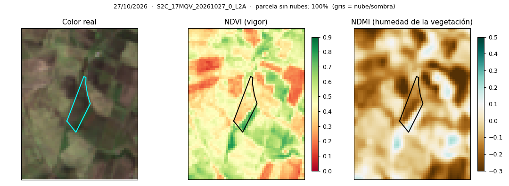

# Reporte semanal 2026-S45: 02/11/2026 al 08/11/2026
**Parcela:** papas_parcela · 1.17 ha · centro -0.749029, -78.773999  

## Alertas para el agricultor
- 🟢 Sin alertas esta semana.
- 🟡 **Vigilar: Heladas**: se cumple la condición actual (T mínima de la semana 3.6 °C (7 noches < 6 °C)), pero no la tendencia del próximo mes (diciembre: madrugadas históricamente normal).

## Sentinel-2 de precisión (10 m, polígono exacto)
**Última captura satelital limpia: hace 12 días** (27/10/2026, nubosidad en el polígono 0 %)  
Comparada con la imagen limpia anterior: 09/10/2026 (18 días antes), cambio de NDVI +0.144

| | Estado | Mensaje para el agricultor |
|---|---|---|
| **Vigor y plagas** (NDVI 0.45, NDRE 0.25) | 🟡 amarillo | Baja concentración de clorofila. Posible falta de nitrógeno o crecimiento lento; revisa fertilización. |
| **Humedad** (NDMI -0.18) | 🔴 rojo | Estrés hídrico detectado en las hojas de la parcela. El cultivo está perdiendo turgencia; activa riego. |

**Salud del lote:** 17 % del área sana (verde) · 83 % con estrés (amarillo + rojo) · 🟢 verde 17 % · 🟡 amarillo 56 % · 🔴 rojo 28 %
  
**Sector más afectado:** oeste (67 % de sus píxeles en rojo)

 

## Detalle de todos los pases del satélite (Sentinel-2 L2A)
| Fecha | Escena | Parcela sin nubes | Nubes | Estado |
|---|---|---|---|---|
| 06/11 | S2C_17MQV_20261106_0_L2A | 100% | 0% | dudosa (bruma) |
| 08/11 | S2A_17MQV_20261108_0_L2A | 0% | 99% | nublado (sin descarga) |

**Último dato válido:** 27/10/2026  
**Comparado con:** 09/10/2026 (18 días antes)

| Índice | Valor | Anterior | Cambio | Qué indica |
|---|---|---|---|---|
| NDVI | 0.448 | 0.304 | 0.144 | vigor / biomasa verde |
| NDMI | -0.181 | -0.319 | 0.138 | humedad de la vegetación |
| NDRE | 0.249 | 0.163 | 0.087 | clorofila / nitrógeno (red edge) |
| EVI | 0.174 | 0.114 | 0.060 | vigor, corrige suelo y atmósfera |
| SAVI | 0.178 | 0.115 | 0.063 | vigor con suelo expuesto |
| BSI | 0.177 | 0.278 | -0.101 | suelo desnudo (más alto = más suelo) |
| NDWI | -0.473 | -0.366 | -0.107 | agua superficial / encharcamiento |
| MSI | 1.523 | 2.043 | -0.520 | estrés hídrico (más alto = más seco) |

## Clima de la semana (Open-Meteo)
| T mín | T máx | T media | HR media | Lluvia | Radiación | Noches < 6 °C |
|---|---|---|---|---|---|---|
| 3.6 °C | 14.4 °C | 8.3 °C | 85 % | 19.1 mm | 21.8 MJ/m²/día | 7 de 7 |

_Fuente: ERA5 (reanálisis); 7 días con dato._

## Tendencia histórica del próximo mes: diciembre (promedio 2011-2025)
| Lluvia | T mín media | Radiación | Nubes de madrugada | Días con T mín < 6 °C |
|---|---|---|---|---|
| 185 mm (normal) | 4.9 °C | 18.5 MJ/m²/día (normal) | 90 % (normal) | 22 |

## Reglas evaluadas (provisionales, ver `reglas.py`)
| Regla | Si hoy ocurre esto | ¿Se cumple? | + Próximo mes | ¿Se cumple? | Resultado |
|---|---|---|---|---|---|
| R1 Riesgo de sequía | Humedad baja en Sentinel-2 (NDMI cayendo): NDMI -0.18 (cambio 0.14 en 18 días) | ❌ | Mes históricamente seco: diciembre: 185 mm históricos (normal) | ❌ | ninguna |
| R2 Plagas y hongos (lancha / tizón tardío) | Humedad alta + temperaturas templadas (15-20 °C): HR media 85 %, T media 8.3 °C | ❌ | Mes históricamente lluvioso: diciembre: 185 mm históricos (normal) | ❌ | ninguna |
| R3 Déficit de nutrientes | Vigor (NDVI) estancado en etapa de crecimiento: NDVI 0.45 (cambio 0.14 en 18 días) | ❌ | Alta radiación solar esperada: diciembre: radiación histórica normal | ❌ | ninguna |
| R4 Heladas | Temperaturas mínimas actuales < 6 °C: T mínima de la semana 3.6 °C (7 noches < 6 °C) | ✅ | Mes de cielos despejados nocturnos: diciembre: madrugadas históricamente normal | ❌ | VIGILAR |
